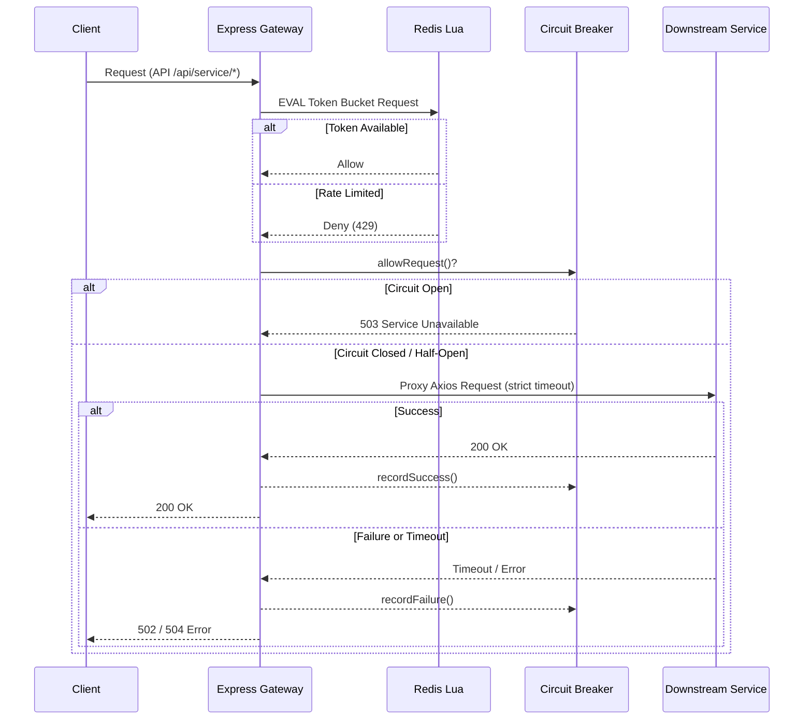

# Gatekeeper API Gateway

Gatekeeper is a production-ready, high-throughput distributed API Gateway written in TypeScript for Node.js. It handles centralized routing, strict downstream timeouts, state machine circuit breaking, and distributed Redis-backed rate limiting.

## Architecture

The system utilizes an embedded Lua script inside Redis to guarantee atomic and race-condition-free token checking and deduction for rate limiting. This architecture choice ensures consistent distributed behavior without the drawbacks of lock-contention or network chattiness compared to fetching state, modifying it in Node.js, and saving it back.



## Features

- **Strict Downstream Timeout:** Hard 1500ms timeout for all proxied downstream requests via `axios`.
- **Fault-Tolerant Circuit Breaker:** Robust state machine (`CLOSED`, `OPEN`, `HALF_OPEN`) tracking sequential failures to shed load off failing downstream services and trigger fast 503s.
- **Atomic Redis Lua Rate Limiting:** Guarantees horizontally scalable rate limits using the Token Bucket algorithm without race conditions.
- **Docker-ready:** Easy deployment via `docker-compose`.

## Engineering Trade-Offs

- **Redis Lua vs In-Memory Map:** Using an embedded Lua script (`EVAL`) rather than Node.js memory prevents race conditions and state sync issues when the Gateway is scaled horizontally across multiple instances or pods. While it incurs a minor Redis network hit per request, the atomic `HMGET`/`HMSET` execution inside the Lua thread solves concurrency flawlessly.
- **Axios vs Native Fetch/HTTP:** `axios` was chosen for proxying due to its simple robust mechanism for timeout cancellation (`ECONNABORTED`), status code abstraction, and stream passing.

## Running Locally

```bash
docker compose up -d
```
